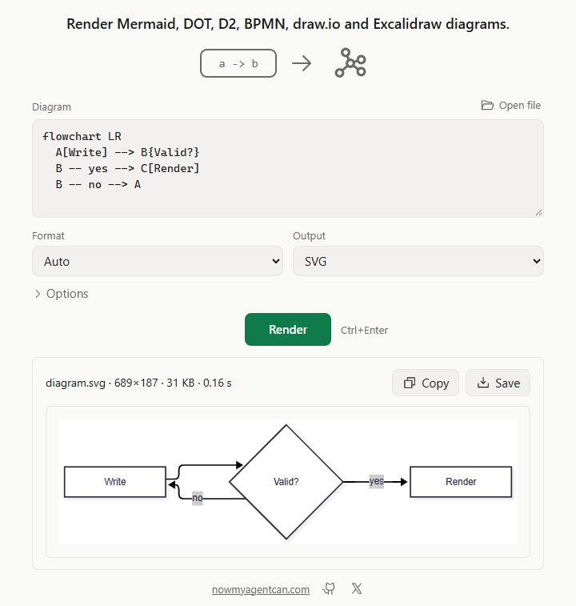

# diagram-render

Turn Mermaid, Graphviz DOT, D2, BPMN, draw.io and Excalidraw files into SVG or PNG on your own computer, with no browser and no server, and check them for errors by line.



## Read this first

This is a first release and it hasn't had a full final test round: the last pass was cut short, and the known issues are listed under [Supported inputs and limits](#known-issues).

- **D2 on Windows:** without `--allow-network`, D2 files using `@` imports, icons, images, or `${...}` with a path are refused with `network_needed`, even if every file is local. So local images need that option. It goes by the text: any `@`, `icon` or `image`, even in a label, or `${` in a file with a `/`, `\` or `<`.
- **`--allow-network`:** with it, D2 can reach network paths, including Windows shares, as well as image URLs. Use it only on diagrams you trust.
- **DOT on Windows:** a network path written in a DOT file stops with `network_path`, but a symlink in DOT can reach a network path. The link needs Developer Mode or elevation to exist.
- **How far "offline" goes on Windows:** it rests on reading the diagram's text, not on a system barrier. A set of hostile files reached no test listener; that's a test set, not a proof.
- **Speed:** the target for a small diagram is 100 ms for BPMN, draw.io and Excalidraw SVGs; Mermaid, DOT and D2 take longer. Large Mermaid and D2 PNGs miss the speed target: the target is 2 s more than the SVG, and on the test PC a 300-node Mermaid flowchart takes 2.8 s more (3.2 s in all) and a 200-shape D2 file 2.1 s more (2.3 s).

## Install

Windows (PowerShell, no admin; installs to `%LOCALAPPDATA%\Programs\diagram-render` and adds it to your user PATH):

```powershell
irm https://github.com/nowmyagentcan/diagram-render/releases/latest/download/install.ps1 | iex
```

macOS and Linux (installs to `~/.local/share/diagram-render`, linked from `~/.local/bin`):

```sh
curl -fsSL https://github.com/nowmyagentcan/diagram-render/releases/latest/download/install.sh | sh
```

| System | Download |
|---|---|
| Windows x64 | [diagram-render-v0.1.0-windows-x64.zip](https://github.com/nowmyagentcan/diagram-render/releases/download/v0.1.0/diagram-render-v0.1.0-windows-x64.zip) |
| macOS Apple silicon | [diagram-render-v0.1.0-macos-arm64.tar.gz](https://github.com/nowmyagentcan/diagram-render/releases/download/v0.1.0/diagram-render-v0.1.0-macos-arm64.tar.gz) |
| macOS Intel | [diagram-render-v0.1.0-macos-x64.tar.gz](https://github.com/nowmyagentcan/diagram-render/releases/download/v0.1.0/diagram-render-v0.1.0-macos-x64.tar.gz) |
| Linux x64 | [diagram-render-v0.1.0-linux-x64.tar.gz](https://github.com/nowmyagentcan/diagram-render/releases/download/v0.1.0/diagram-render-v0.1.0-linux-x64.tar.gz) |
| Linux arm64 | [diagram-render-v0.1.0-linux-arm64.tar.gz](https://github.com/nowmyagentcan/diagram-render/releases/download/v0.1.0/diagram-render-v0.1.0-linux-arm64.tar.gz) |

Each archive holds everything it needs: the program, three engines, the fonts and the licences. Keep the folder together. To remove it, delete the folder.

## Use

```sh
$ diagram-render flow.mmd -o flow.png
✓ flow.mmd → flow.png  1378×374  13 KB  0.17 s

$ diagram-render check flow.mmd
✓ flow.mmd is valid Mermaid (flowchart)
```

The format comes from the file name or its content. Without `-o`, `flow.svg` is written beside the input.

```sh
diagram-render graph.dot --to png --scale 3
diagram-render board.drawio --page 2 -o page2.svg
diagram-render sketch.excalidraw --to png --background transparent
echo "graph TD; A-->B" | diagram-render - --format mermaid -o ab.png
diagram-render formats
```

`diagram-render` alone starts an interactive prompt: type or drop a file, add `png` for a PNG.

`diagram-render ui` opens a local page to paste or drop a diagram and see it, and double-clicking the Windows exe does the same. The page runs on 127.0.0.1 and writes nothing to disk.

### Use with AI agents

`--json` on `render`, `check` and `formats` prints one JSON object; errors are `{"error": {"code", "message", "hint"}}`, with `line`, `column` and `excerpt` when the problem has a place in the source.

```sh
diagram-render check flow.mmd --json            # errors with line and column
diagram-render flow.mmd -o flow.png --json      # writes flow.png; then open it to look
cat graph.dot | diagram-render - --format dot -o graph.svg --json
```

`diagram-render mcp` is a local MCP server on stdio with two tools: `check_diagram`, and `render_diagram`, which returns a PNG preview so the model can see what it drew.

| Agent | Setup |
|---|---|
| Claude Code | `claude mcp add diagram-render -- diagram-render mcp` |
| Codex | `codex mcp add diagram-render -- diagram-render mcp` |
| Cursor (`~/.cursor/mcp.json`), Claude Desktop | `{"mcpServers":{"diagram-render":{"command":"diagram-render","args":["mcp"]}}}` |
| VS Code (`.vscode/mcp.json`) | `{"servers":{"diagram-render":{"type":"stdio","command":"diagram-render","args":["mcp"]}}}` |

## Supported inputs and limits

| Format | Files | Drawn by |
|---|---|---|
| Mermaid | `.mmd` `.mermaid` | merman 0.9.3; `diagram-render formats --json` lists its diagram families |
| Graphviz DOT | `.dot` `.gv` | Graphviz 16.1.0, all 8 layouts |
| D2 | `.d2` | d2 0.9.0, with dagre, elk and tala |
| BPMN 2.0 | `.bpmn` `.bpmn2` | this tool, from the file's diagram section |
| draw.io | `.drawio` `.dio` `.drawio.xml` `.drawio.svg` `.drawio.png` | this tool |
| Excalidraw | `.excalidraw` `.excalidraw.json` `.excalidraw.svg` `.excalidraw.png` | this tool |

- Input: one diagram per run, up to 64 MiB, and 4 MiB for Mermaid, DOT and D2 text.
- A render stops at its `--timeout` (60 s unless you set it) and at 4 GiB of memory, and ends with the run that started it.
- Output: SVG or PNG. PNGs stop at 16384 px a side and 64 MP; a larger diagram comes out at a lower scale, with a warning.
- Every SVG loses its scripts, event handlers and `javascript:` links.
- draw.io vendor shape libraries (such as `mxgraph.aws4.*`) and stencils are drawn as dashed boxes with their labels, and the run warns about them.
- A BPMN file with no diagram section isn't laid out; open it in a BPMN modeler and save it to add one.
- Text in PNGs uses the bundled fonts. Characters they don't have, such as Chinese, Japanese or Korean, come from this computer's fonts, with a warning, so those images can differ between computers.
- Graphviz `image=` files stay links in the SVG and are left out of PNGs.
- Not read: PlantUML, Visio, or Markdown files with diagrams inside. Not written: PDF, JPEG or animated SVG.
- It has no telemetry, update check or account. Apart from what's listed in [Read this first](#read-this-first), the one network use is D2 with `--allow-network`, which fetches the image URLs written in your diagram. The installers download from GitHub.
- On Linux and macOS, without that option, D2 SVGs keep remote images as links, which your viewer may fetch; D2 PNGs that need them stop with `network_needed`. On Windows such a file stops with `network_needed` in both.
- On Windows a path such as `//host/x.png` makes the system contact that host. MCP `path` and `output` refuse network paths, but follow a link to a share. A path you type on the command line is opened as given. On Linux `//host/x.png` is a plain local path; macOS `/net/host/...` automounts weren't tested.

### Known issues

- A browser or MCP client that leaves or cancels doesn't stop its render; the next one waits for it, up to the time limit. MCP `ping` waits too.
- Requests piped into `diagram-render mcp` can lose an answer when stdin closes at once (rare; a client that keeps stdin open is fine). Malformed JSON gets no reply.
- In a DOT file with several graphs only the first is drawn, yet a bad or slow later graph still fails the run, and its error can name the wrong line.
- `--page 2` doesn't pick a D2 board by number; give its path, such as `layers.deploy`.
- Files with bare CR line ends get wrong line numbers and can be read as the wrong format.
- On Windows an input folder over 260 characters fails for Mermaid, DOT and D2 with `engine_failed` and a misleading "Reinstall" hint. So can a run out of memory.
- Numbers too big for a float in BPMN, draw.io or Excalidraw files give an SVG holding `inf` with exit 0; a PNG can fail with `internal`.
- draw.io cells that parent each other vanish: a blank SVG, exit 0, no warning.
- With `--allow-network`, a D2 image URL that answers with a non-image gives an SVG without it and exit 0, with a misleading warning or none. A PNG stops with an error.
- `SSL_CERT_FILE` doesn't reach d2; a private CA must be in the system store.
- A DOT `network_path` message can show the rest of the source line after the path.
- The Windows installer doubles a `;` that ends the user PATH. Deleting the folder leaves the PATH entry, or the `~/.local/bin` link.
- Testing gaps: on Windows the proxy use under `--allow-network` has no test, and two more D2 tests that start from offline remote images don't run there. D2's `image` fixture is compared there only with `--allow-network`; the network-path place test covers Windows and DOT alone. The piped MCP answer loss has no test.
- Two tests have failed under heavy load on Linux, one for an unproven cause. One memory test's assertion is looser than it should be, and one doc comment in the source is misplaced. Some minor findings of the last pass were never written down, so they aren't listed here.

## How it works

Mermaid, DOT and D2 go to [merman](https://github.com/Latias94/merman), [Graphviz](https://graphviz.org) and [D2](https://github.com/d2lang/d2), each an unmodified program in `engines/`, run with a clean environment, a time limit and a memory limit.
BPMN, draw.io and Excalidraw are drawn by this tool's own Rust renderers, with geometry ported from [mxGraph](https://github.com/jgraph/drawio), [Excalidraw](https://github.com/excalidraw/excalidraw) and [rough.js](https://github.com/rough-stuff/rough).
PNGs come from [resvg](https://github.com/linebender/resvg), or from merman's and d2's own rasterisers for their diagrams.

## First run on an unsigned build

Windows: if "Windows protected your PC" appears, choose More info, then Run anyway.
The install script doesn't trigger it; a zip extracted in Explorer may.

macOS: if it says the developer can't be verified, open System Settings, Privacy & Security, and choose Open Anyway.
Every engine in a browser-downloaded archive carries the same flag, so clear them at once with `xattr -dr com.apple.quarantine <unpacked folder>`.
The install script doesn't trigger it, because curl downloads carry no quarantine flag.

## Licence

Apache-2.0, see [LICENSE](LICENSE). [NOTICE](NOTICE) lists the bundled engines with their sources and the code ported into this repository. Each release archive includes every third-party licence in `licenses/`.

---

[nowmyagentcan.com](https://nowmyagentcan.com) · [x.com/chayp05](https://x.com/chayp05)
